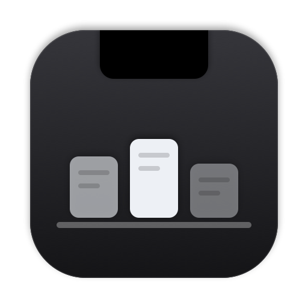
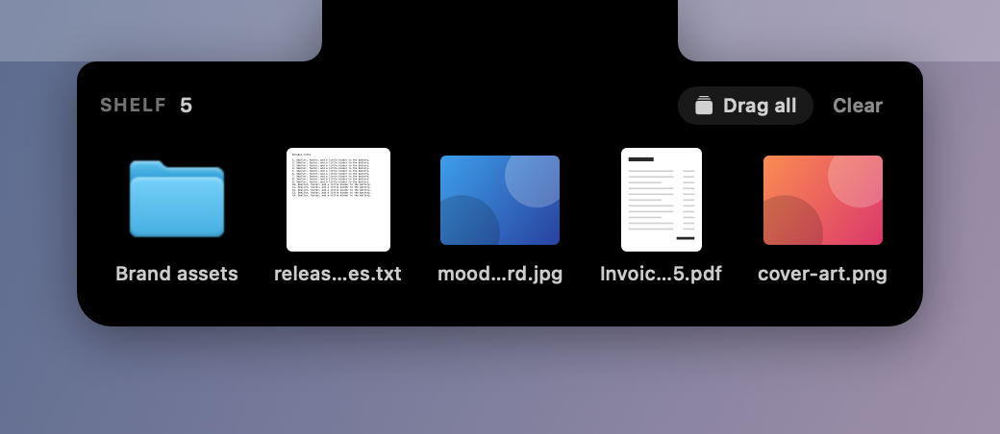
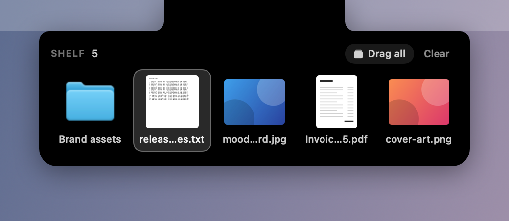
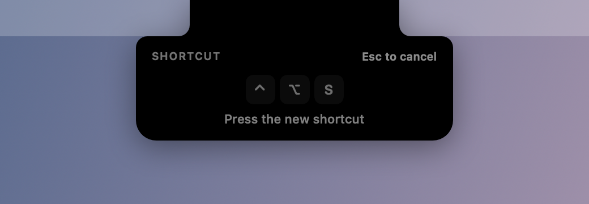

<p align="center">
  
</p>

<h1 align="center">Notchshelf</h1>

<p align="center">
  A shelf for files that lives in the MacBook notch.<br>
  Drag something up to park it. Drag it back out wherever you need it.
</p>

<p align="center">
  <a href="https://github.com/BRIJRAJ-02/notchshelf/actions/workflows/ci.yml"></a>
  
  
  
</p>

<p align="center">
  
</p>

## What it does

Moving a file between two apps usually means lining up two windows first. Notchshelf gives you somewhere to put the file down in between.

- **Appears when you pick something up.** Start dragging a file anywhere and a lip drops out of the notch. Carry the file to it and the shelf opens.
- **Holds references, not copies.** Parked files stay where they are on disk. Rename or move one and the shelf follows it; delete it and it leaves the shelf.
- **Takes things that are not files yet.** A photo from Photos or an image from a browser arrives as a promise; the shelf asks for the file and keeps it until you drag it out.
- **Lets go when you are done.** Drag a file out to Finder, Mail, Slack, a browser upload field or anywhere else, and it leaves the shelf. *Drag all* takes everything at once.
- **Shows you what you parked.** Press Space on a file and Quick Look opens from its tile. The arrow keys step through the rest of the shelf.
- **Works without the mouse.** Control-Option-S opens the shelf from anywhere. Arrows to choose, Return to open, Command-C to copy, Delete to take it off the shelf.
- **Stays out of the way.** An empty shelf shows nothing. A shelf with files shows a small count beside the notch.
- **Remembers.** The shelf survives a restart.

<p align="center">
  
</p>

<p align="center">
  
</p>

## Install

### Download

Get `Notchshelf-x.y.z.dmg` from the [latest release](https://github.com/BRIJRAJ-02/notchshelf/releases/latest), open it and drag Notchshelf to Applications. It runs on Apple Silicon and Intel, macOS 14 or later.

The app is not notarized, so macOS blocks the first launch. Either allow it under System Settings → Privacy & Security → Open Anyway, or run:

```bash
xattr -dr com.apple.quarantine /Applications/Notchshelf.app
```

### Build from source

Requires Xcode 16 or later (for the Swift toolchain).

```bash
git clone https://github.com/BRIJRAJ-02/notchshelf.git
cd notchshelf
./scripts/build-app.sh --install   # builds, copies Notchshelf.app to /Applications, launches it
```

## Using it

| Do this | To |
|---|---|
| Drag a file to the notch | Park it |
| Hover the count beside the notch | Open the shelf |
| Drag a tile out | Drop the file somewhere and take it off the shelf |
| Drag *Drag all* | Take every file at once |
| Double-click a tile | Open the file |
| Hover a tile and press Space | Look at the file in Quick Look |
| Hover a tile and click × | Take it off the shelf, leaving the file alone |
| Right-click a tile | Quick Look, Open, Show in Finder, Copy, Remove from Shelf |
| Click the tray icon in the menu bar | Open Shelf, Clear Shelf, Change Shortcut, Turn Off Shortcut, Keep Files After Dragging Out, Launch at Login, Quit |

Dropping on Finder moves or copies exactly as dragging the file itself would: a move on the same disk, a copy across disks, Option to force a copy.

On a display without a notch (an external monitor, or the lid closed) the shelf hangs from the bottom of the menu bar instead.

### From the keyboard

<p align="center">
  
</p>

| Press | To |
|---|---|
| Control-Option-S | Open the shelf with the first file selected, or close it |
| Left and Right | Move the selection. A press at either end wraps around; a held key stops there |
| Space | Open Quick Look for the selected file, and close it again |
| Left and Right in Quick Look | Look at the previous or next file on the shelf |
| Return | Open the file |
| Command-C | Copy the file, ready to paste into Finder, Mail or a chat |
| Delete | Take it off the shelf, leaving the file alone |
| Esc | Close Quick Look, or the shelf |

The same keys work on a shelf you opened with the pointer. They act on the tile under it, and the first arrow key starts a selection from there.

A shelf opened from the keyboard stays open until you press Esc or the shortcut again, open a file, or click somewhere else.

To use a different shortcut, choose *Change Shortcut* from the menu bar icon and press the new one. It needs Control or Command in it, or a function key alone. Esc keeps the one you had. *Turn Off Shortcut* removes it.

<p align="center">
  
</p>

The default is Control-Option-S because macOS keeps Control-Option-Space for switching keyboard layouts.

While the shelf is open and the pointer is on it, or while it was opened from the keyboard, your key presses go to the shelf and not to the app behind it. That app stays in front the whole time. Quick Look is the one exception: its window needs Notchshelf in front, so the app you were in comes back when the shelf lets go.

### With Notchload

[Notchload](https://github.com/BRIJRAJ-02/notchload) uses the strip under the notch, so the two share it. With Notchload running, the notch itself still opens Notchload and the count beside it opens the shelf. While the shelf is open or a file is in the air, Notchshelf tells Notchload to stay closed.

## Design notes

- **The notch is the anchor.** Everything is one black path that grows out of the hardware: an ear for the count, a lip for the drop target, a body for the shelf.
- **Nothing until there is something.** No idle chrome. The shelf only draws when it holds files or when a file is in the air.
- **A target you can see.** The lip appears as soon as a drag starts, so there is no guessing where to aim.
- **Patient with the pointer, not with a drag.** Hover waits a beat before opening. A file being carried opens it at once.
- **Click-through.** The window ignores the mouse everywhere outside the visible shape.
- **Careful with your files.** The shelf never deletes or moves a file you parked. The only files it removes are its own copies of promised drops.
- **Keys land at once.** A key press never waits for an animation. The shelf opens, closes and loses a file immediately; only the selection glides, briefly, so you can see where it went.
- **Respectful motion.** One spring, and a plain fade with Reduce Motion.

## How it is built

```
Sources/
  NotchshelfCore/   UI-free shelf: the list, bookmarks, persistence, cleanup of promised drops,
                    and the keyboard rules: where the selection goes, how a shortcut is stored, which key does what
  Notchshelf/       the panel: window placement, drag detection, drop and drag-out, keys and Quick Look, SwiftUI views
Tests/              the shelf store: duplicates, persistence, moved and deleted files, what may be deleted;
                    selection movement, shortcut encoding, the key table
scripts/            build-app.sh bundles the app and the DMG; make-icon.swift draws the icon in code
```

How the parts work:

| Part | How |
|---|---|
| Noticing a drag | A global mouse monitor watches the drag pasteboard's change count; only its types are read, never its contents |
| Receiving drops | An AppKit drag destination under the SwiftUI views, for file URLs and `NSFilePromiseReceiver` |
| Dragging out | An `NSDraggingSession`, so the shelf learns whether the drop landed |
| Following files | URL bookmarks, resolved each time the shelf opens |
| Thumbnails | `QLThumbnailGenerator` |
| The global shortcut | Carbon's `RegisterEventHotKey`, which needs no accessibility permission |
| Keys on the shelf | An invisible non-activating panel takes keyboard focus while the shelf can use it and is ordered out to give it back; the visible panel never becomes key |
| Quick Look | `QLPreviewPanel`, zooming from the tile's thumbnail and back |
| Storage | `~/Library/Application Support/Notchshelf` |

Nothing leaves your Mac. macOS may ask once for access to Desktop, Documents or Downloads when the shelf checks on files parked from there.

### Developing

```bash
swift build && swift test       # or open Package.swift in Xcode
./scripts/build-app.sh --open   # build and launch the app bundle
./scripts/build-app.sh --dmg    # universal build, packaged as build/Notchshelf-<version>.dmg
.build/debug/Notchshelf --snapshot docs               # re-render the README screenshots with sample files
.build/debug/Notchshelf --store /tmp/shelf --add a.png b.pdf   # run against a throwaway shelf
```

## License

[MIT](LICENSE)
